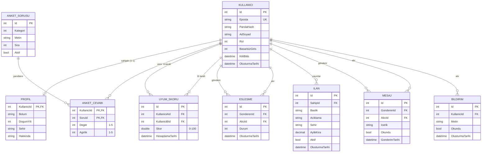

# ER Diyagramı

## İlişkiler

| Tür | Örnek | Nasıl kuruldu |
| --- | --- | --- |
| 1-1 | Kullanıcı — Profil | `Profil.KullaniciId` hem birincil hem yabancı anahtar. Bir kullanıcının en fazla bir profili olabilir. |
| 1-N | Kullanıcı — İlan | `Ilan.SahipId` yabancı anahtarı. Bir kullanıcı birden çok ilan verebilir. |
| N-N | Kullanıcı — Anket sorusu | `AnketCevabi` ara tablosu. Birleşik birincil anahtar `(KullaniciId, SoruId)` aynı soruya iki kez cevap verilmesini engeller; tablo ayrıca `Deger` ve `Agirlik` taşır. |

## Normalizasyon

- **1NF:** Her alan tek değer tutar. Tercihler tek bir metin alanına virgülle yazılmaz, her biri `AnketCevabi` satırıdır.
- **2NF:** `AnketCevabi` içindeki `Deger` ve `Agirlik` birleşik anahtarın tamamına bağlıdır. Soru metni bu tabloda tekrar edilmez.
- **3NF:** Soru metni yalnızca `AnketSorusu`, kişisel bilgiler yalnızca `Kullanici` ve `Profil` tablosundadır.

`UyumSkoru`, cevaplardan hesaplanabilen bir değerdir. Her listelemede tüm çiftleri yeniden hesaplamamak için bilinçli olarak saklanır.
