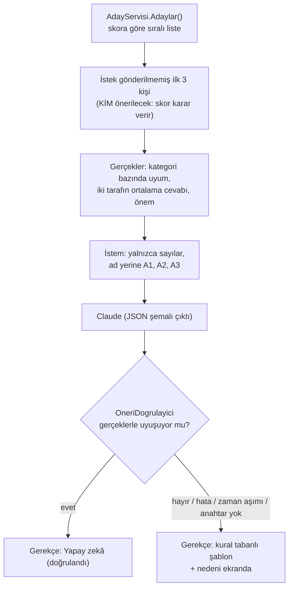

# Hafta 10: Yapay Zekâ Bileşeni: Açıklamalı Uyum Önerisi

Öğrenciye, henüz istek göndermediği en uyumlu 3 kişi önerilir. Her öneride kısa bir gerekçe, güçlü yönler ve "baştan konuşun" denecek bir konu bulunur. Gerekçeyi bir dil modeli (Claude) yazar. Çıktı, veritabanından hesaplanan gerçek değerlerle karşılaştırılarak doğrulanır.

## Skor + yapay zekâ nasıl birleşiyor?



- **Kim önerilecek:** Buna uyum skoru (`UyumHesaplayici`, 7. hafta) karar verir. Yapay zekâ sıralamayı değiştiremez, yeni kişi ekleyemez. Doğrulayıcı bilinmeyen veya eksik aday kodunu reddeder.
- **Neden uygun olduğu:** Bunu yapay zekâ yazar, yalnızca verilen sayılara dayanarak.
- **Sonuç:** Skor kararın açıklanabilir ve test edilebilir kalmasını sağlar. Yapay zekâ bu kararı okunur bir dille anlatır.

## İstem (prompt) tasarımı

Kod: [`OneriIstemi.cs`](../src/UyumEslestirme.Business/Oneri/OneriIstemi.cs).

| İlke | Uygulama |
| --- | --- |
| **Rol ve görev açık** | "Adaylar skorla zaten seçildi; sen yalnızca neden uygun olduklarını yaz." |
| **Yalnızca veri** | Modele kategori bazında uyum yüzdesi, iki tarafın ortalama cevabı (1-5) ve ortak önem gider. |
| **Kişisel veri yok** | Ad, e-posta, bölüm, şehir ve "hakkında" metni gönderilmez; kişiler A1, A2, A3 kodlarıyla anılır (KVKK). |
| **Enjeksiyona kapalı** | Kullanıcıların yazdığı serbest metin istemde hiç yer almaz. Örneğin "hakkında" alanına "önceki talimatları unut" yazılsa bile modele ulaşmaz. |
| **Kurallar ölçülebilir** | "Yüzde yazarsan yalnızca verideki değerleri yaz", "uyumu 60'ın altındaki konu güçlü yön değildir", "en düşük konu 75'in altındaysa dikkat konusu yaz". Doğrulayıcı aynı kuralları denetler. |
| **Biçim sabit** | Structured outputs: yanıt bir JSON şemasına uymak zorunda. `guclu_yonler` ve `dikkat_konusu` alanları yalnızca 5 kategori kodundan (ve "Yok") birini alabilir. |
| **Hassas konular** | "Cinsiyet, din, köken, sağlık gibi konulara hiç değinme." |

Örnek istem verisi (A1 için kısaltılmış):

```json
{ "kod": "A1", "genel_uyum": "82",
  "kategoriler": [
    { "kod": "Gurultu", "ad": "Sessizlik isteği", "uyum": "100", "kullanicinin_ortalama_cevabi": "4.0", "adayin_ortalama_cevabi": "4.0", "ortak_onem": "5.0" },
    { "kod": "Temizlik", "ad": "Düzen ve temizlik", "uyum": "50", "kullanicinin_ortalama_cevabi": "5.0", "adayin_ortalama_cevabi": "3.0", "ortak_onem": "4.0" } ] }
```

Beklenen çıktı:

```json
{ "oneriler": [ { "kod": "A1",
  "gerekce": "Sessizlik isteğiniz tamamen aynı (%100) ve gece düzeniniz çok yakın; genel uyumunuz %82.",
  "guclu_yonler": ["Gurultu", "UykuDuzeni"],
  "dikkat_konusu": "Temizlik",
  "dikkat_notu": "Ortak alanların düzeni ve temizlik paylaşımını baştan konuşmanız iyi olur." } ] }
```

## Çıktı doğrulama

Kod: [`OneriDogrulayici.cs`](../src/UyumEslestirme.Business/Oneri/OneriDogrulayici.cs). Tek bir kural bile bozulursa **bütün** çıktı reddedilir.

| Kontrol | Yakaladığı hata |
| --- | --- |
| Geçerli JSON, `oneriler` dizisi var | Boş, yarım veya biçimsiz yanıt |
| Her aday tam bir kez, bilinmeyen kod yok | Sıralamayı değiştirme, kişi uydurma, kişi atlama |
| Gerekçe 20-400 karakter | Boş veya aşırı uzun metin |
| Metindeki her `%sayı` gerçek bir değere (±1) eşit | **Uydurulmuş istatistik** (halüsinasyon) |
| Güçlü yönlerin uyumu ≥ 60 | Gerçeğe aykırı övgü |
| En düşük konu < 75 ise dikkat konusu "Yok" olamaz | Sorunu gizleme |
| Dikkat konusu en düşük iki kategoriden biri | Yanlış konuya dikkat çekme |
| `@`, web adresi, telefon numarası, `A1` gibi kod yok | İletişim bilgisi uydurma, iç kodların ekrana sızması |

Kural tabanlı gerekçe (`OneriServisi.KuralTabanliOneri`) aynı kuralları kendiliğinden sağlar. Testlerde geçerli yapay zekâ yanıtı bu şablondan üretilir.

## Hatalı veya boş çıktı yönetimi

| Durum | Kullanıcının gördüğü |
| --- | --- |
| Çıktı doğrulamadan geçti | Gerekçe, "Gerekçeyi yazan: Yapay zekâ (doğrulandı)" etiketi |
| Doğrulamadan geçmedi | Kural tabanlı gerekçe + "Yapay zekâ yanıtı doğrulamadan geçmedi (ilk iki neden)…" |
| Servis hatası (bağlantı, 5xx, hız sınırı) | Kural tabanlı gerekçe + "Yapay zekâ servisine ulaşılamadı (…)" |
| 45 saniyede yanıt yok | Kural tabanlı gerekçe + "zamanında yanıt vermedi" |
| Model reddetti veya yanıt kesildi (`stop_reason` ≠ `end_turn`) | Hata sayılır, kural tabanlı gerekçe |
| Anahtar tanımlı değil (veya web demosu) | Kural tabanlı gerekçe + "Yapay zekâ servisi bu sürümde tanımlı değil" |
| Önerilecek kimse yok | "Şu an önerilecek yeni kişi yok." Modele istek atılmaz. |

Öneri ekranı hiçbir durumda boş kalmaz veya çökmez.

## Model ve API

| Alan | Değer |
| --- | --- |
| SDK | Anthropic resmi C# SDK'si (`Anthropic` NuGet paketi), [`ClaudeIstemcisi.cs`](../src/UyumEslestirme.Api/YapayZeka/ClaudeIstemcisi.cs) |
| Model | `claude-opus-5-5` (`YapayZeka:Model` ayarıyla değiştirilebilir) |
| Çıktı | `output_config.format` = JSON şeması (structured outputs), `effort: low` (kısa iş, düşük maliyet) |
| Ret durumu | Sunucu tarafı yedek model (`fallbacks: "default"`, beta) |
| Anahtar | `ANTHROPIC_API_KEY` ortam değişkeni (veya `YapayZeka__Anahtar`). Depoda yok, tarayıcıya gitmez. |
| Hız sınırı | `/api/oneriler` kullanıcı başına dakikada 5 istek (ücretli çağrı) |

## Bu işlevi yapay zekâ olmadan yapabilir miydik?

Evet, kural tabanlı şablon tam bunu yapar: "Genel uyumunuz %82. En uyumlu olduğunuz konular: sessizlik isteği (%100) ve gece düzeni (%90)."

| | Kural tabanlı | Yapay zekâ |
| --- | --- | --- |
| Doğruluk | Her zaman doğru, test edilebilir | Doğrulamadan geçerse doğru |
| Dil | Kalıp cümle, her öneri aynı biçimde | Doğal, bağlama göre (örneğin "ikiniz de evde yoğun çalışıyorsunuz") |
| Maliyet / süre | Yok / anında | Ücretli / birkaç saniye |
| Bağımlılık | Yok | İnternet ve anahtar |

Bu yüzden kural tabanlı yol **yedek** olarak kaldı. Yapay zekâ yalnızca dili iyileştirir; karar ve doğruluk deterministik koddadır.

## Etik ve şeffaflık

- **Kaynak etiketi:** Ekranda gerekçeyi kimin yazdığı yazar.
- **Kural metni:** Sayfanın altında kuralın kendisi açıklanır: kişiler skorla seçilir, yapay zekâ sıralamayı değiştirmez, kişisel veri gönderilmez.
- **Sınırlı veri:** Modele gönderilen veri en aza indirildi (yalnızca sayılar).
- **Hassas konular:** Hassas konular istemde yasak.
- **Tek öneri, karar kullanıcıda:** Öneri yalnızca bir öneridir; istek gönderme kararı kullanıcıdadır.

## Testler

| Dosya | Ne sınar |
| --- | --- |
| `OneriTestleri.cs` | Sıralamayı skor belirler, istemde ad/e-posta/bölüm yok, istek gönderilmiş kişi önerilmez, servis hatası, zaman aşımı, boş/bozuk JSON, uydurulmuş yüzde, yapay zekâ yokken çalışma, aday yokken modele istek atılmaz, yönetici öneri alamaz |
| `OneriDogrulayiciTestleri` | Her doğrulama kuralı tek tek (geçerli çıktı, bilinmeyen kod, yanlış yüzde, ±1 tolerans, e-posta, telefon, aday kodu, düşük uyumlu güçlü yön, atlanan dikkat konusu, eksik aday) |
| `Hafta9Ve10ApiTestleri.cs` | `/api/oneriler` sahte Claude ile yapay zekâ kaynaklı sonuç, bozuk çıktıda kural tabanlı sonuç |

Testler gerçek modeli çağırmaz (`SahteYapayZeka`, `SahteClaude`); hızlı, ücretsiz ve her seferinde aynı sonucu verir.

## Sözlü sınav hazırlığı

**1. AI önerisini skorla nasıl birleştirdin?**
Kimin önerileceğini skor belirler: Arkadaş bul listesindeki sıraya göre, istek gönderilmemiş ilk 3 kişi. Yapay zekâya bu 3 kişinin kategori bazında değerleri verilir, o yalnızca gerekçe yazar. Doğrulayıcı, yapay zekânın bu kişileri değiştirmediğini ve yazdığı yüzdelerin gerçek skorlarla aynı olduğunu denetler.

**2. Öneriyi neden gerekçelendirdin?**
"%82 uyumlu" tek başına neden uygun olduğunu söylemiyor. Gerekçe hangi konularda benzer olunduğunu ve neyin konuşulması gerektiğini gösteriyor. Kullanıcı öneriye körü körüne değil bilerek karar veriyor; bu aynı zamanda şeffaflık gereği.

**3. İstemini nasıl tasarladın?**
Sistem isteminde rol, görev ve ölçülebilir kurallar var. Kullanıcı isteminde yalnızca sayılar var, kişiler kodla anılıyor. Çıktı JSON şemasıyla sınırlı, kategori alanları sabit listeden seçiliyor. Kurallar doğrulayıcıdaki kontrollerle bire bir aynı, böylece "kurala uydu mu" kodla ölçülebiliyor.

**4. AI çıktısı hatalıysa ne yapıyorsun?**
Çıktının tamamı reddediliyor ve kural tabanlı gerekçe gösteriliyor. Ekranda yapay zekânın neden kullanılmadığı yazıyor. Aynı şey servis hatası, zaman aşımı ve anahtar yokken de oluyor; ekran hiçbir zaman boş kalmıyor.

**5. Bu işlevi AI olmadan yapabilir miydin, farkı ne?**
Evet, kural tabanlı şablon aynı bilgiyi veriyor ve yedek olarak kullanılıyor. Fark dilde: yapay zekâ cevaplardan anlamlı, doğal cümle kuruyor, şablon her öneride aynı kalıbı tekrarlıyor. Karşılığında maliyet, gecikme ve doğrulama ihtiyacı geliyor.

## Demo (yaklaşık 3 dakika)

1. `ANTHROPIC_API_KEY` tanımlıyken API'yi çalıştır, öğrenci hesabıyla gir, anketi doldur.
2. **Önerilenler** → **Önerileri getir**. 3 kişi, gerekçe, güçlü yönler ve "Konuşun" etiketi görünür, kaynak "Yapay zekâ (doğrulandı)".
3. Skor sırasının Arkadaş bul sayfasındaki sırayla aynı olduğunu göster.
4. Anahtarı kaldırıp API'yi yeniden başlat: aynı ekran "Kural tabanlı şablon" etiketi ve nedeniyle çalışır.
5. Kodda `OneriDogrulayici` içindeki yüzde kontrolünü ve `Uydurulmus_yuzde_iceren_cikti_reddedilir` testini göster.

## Bilinen sınırlar

- **Maliyet:** Her "Önerileri getir" bir model çağrısıdır. Sonuç önbelleğe alınmaz; kullanıcı başına dakikada 5 istekle sınırlıdır.
- **Doğrulamanın kapsamı:** Doğrulayıcı sayıları ve kategorileri denetler, cümlenin anlamını denetleyemez. Örneğin "ikiniz de sabahçısınız" yorumu cevaplarla çelişebilir. Bu yüzden istem modelden yalnızca verilere dayanmasını ister ve kaynak etiketi her zaman gösterilir.
- **Web demosu ve masaüstü:** GitHub Pages demosunda ve masaüstünde anahtar olmadığından gerekçeler kural tabanlıdır. Masaüstünde Önerilenler ekranı henüz yok.
