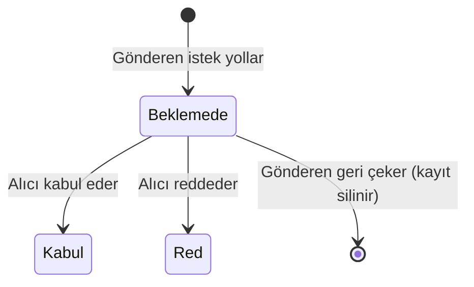

# Hafta 7: Uyum Skorlama ve Eşleştirme

## Modüller

| Sınıf | Görev |
| --- | --- |
| `UyumHesaplayici` | Skorlama fonksiyonu, saf hesap ([ayrıntı](uyum-skoru.md)) |
| `UyumServisi` | Skoru `UyumSkoru` tablosundan okur, yoksa hesaplayıp yazar |
| `AdayServisi` | "Arkadaş bul" listesi: uygun adayları süzer ve uyuma göre sıralar |
| `EslesmeServisi` | İstek gönderme, kabul/ret, geri çekme ve eşleşme listeleri |

## Veri modeli

- **`Eslesme`:** `GonderenId`, `AliciId`, `Durum` (`Beklemede`, `Kabul`, `Red`) ve tarih alanlarından oluşur. `(GonderenId, AliciId)` benzersizdir ve `CHECK (GonderenId <> AliciId)` kendine istek gönderilmesini engeller.
- **`UyumSkoru`:** İki kişi arasındaki skorun önbelleğidir. Her çift için tek satır tutulur.
- **`Profil.Gorunur`:** Kullanıcının profilini listede gösterip göstermeyeceği. `ProfilGorunurlugu` migration'ı ile eklendi; mevcut profiller için varsayılan değer `true`.

## Eşleştirme akışı

## İş kuralları

| Kural | Neden |
| --- | --- |
| Kendine istek gönderilemez | Anlamsız kayıt. Veritabanında `CHECK` ile de korunur. |
| İki kişi arasında tek istek olur, ters yönde de yeni istek açılamaz | Çift kayıt ve çelişkili durum oluşmaz. |
| İstek için iki tarafın da anketi tamamlanmış olmalı | Skoru olmayan kişiyle eşleşme anlamsız. |
| Gizli, anketsiz, yönetici veya olmayan kullanıcıya istek gönderilemez, hepsi aynı mesajı verir | Mesaj kimin var olduğunu veya gizlendiğini açığa vurmaz. |
| Yanıt bekleyen en fazla 10 istek olabilir | Herkese istek atma (spam) engellenir. |
| İsteği yalnızca alıcı yanıtlar, yalnızca bir kez | Sahiplik kontrolü: başkası adına kabul edilemez. |
| İsteği yalnızca gönderen ve yalnızca yanıt beklerken geri çeker | Yanıtlanmış bir karar geri alınamaz. |
| Reddedilen istek tekrarlanamaz, iki taraf birbirini listede görmez | Israrlı istekler engellenir. |
| Yalnızca öğrenciler eşleşir | Yönetici hesapları arkadaş aramaz. |

## Gizlilik

- **Görünürlük:** Profil, Profil sayfasındaki seçenekle gizlenebilir. Gizli profil listelenmez ve yeni istek alamaz.
- **İletişim bilgisi:** E-posta yalnızca iki taraf da kabul ettikten (`Kabul`) sonra gösterilir.
- **Hassas alanlar:** Listede doğum yılı yerine yaş görünür; tek tek anket cevapları ve parola özeti hiçbir ekrana taşınmaz. `AdayOzeti` ve `EslesmeOzeti` bu alanları hiç içermez.
- **Yetki kontrolü:** Tüm kontroller iş katmanında yapılır, testlerle doğrulanır.

## Diğer modüllerle entegrasyon

- **Kimlik doğrulama (Hafta 5):** İşlemler açık oturum ve öğrenci rolü ister.
- **Profil ve anket (Hafta 6):** Cevaplar skorun girdisidir. Anket kaydı, önbellekteki skorları aynı transaction içinde siler.
- **Veri katmanı (Hafta 4):** Yeni depolar `EslesmeDeposu` ve `UyumSkoruDeposu` aynı `Depo<T>` tabanını kullanır.
