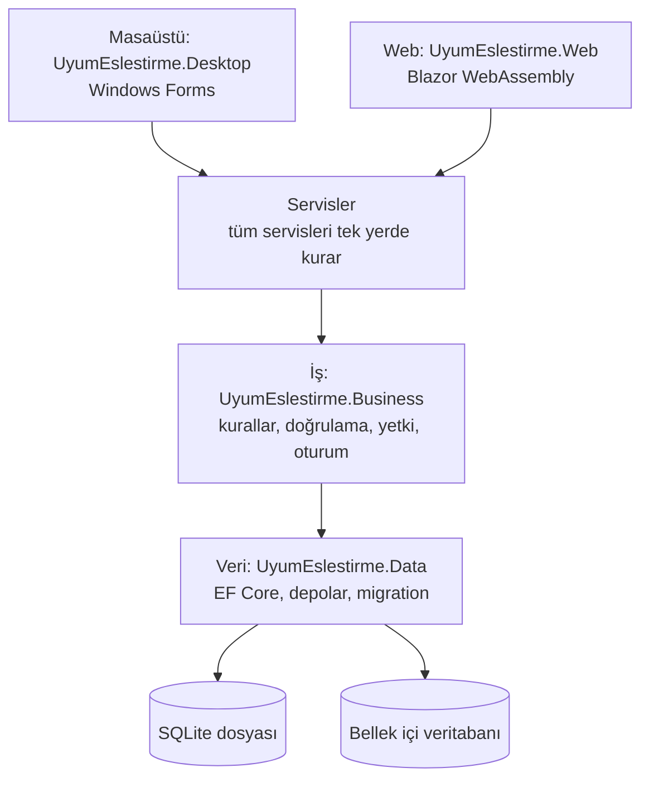

# Hafta 8: Ara Sürüm, Entegrasyon ve Sözlü Hazırlık

Bu hafta yeni modül eklenmedi. 3-7. haftalarda yazılan modüller uçtan uca birlikte sınandı, bilinen bir güvenlik hatası giderildi ve çalışan ara sürüm `v0.1.0` olarak etiketlendi.

## Ara sürüm: v0.1.0

| Alan | Değer |
| --- | --- |
| Sürüm | `0.1.0`, `Directory.Build.props` içindeki `<Version>` alanında |
| Git etiketi | `v0.1.0` |
| Ekranda | Giriş ekranında (masaüstü ve web) ve web menüsünün altında |
| Değişiklik listesi | [CHANGELOG.md](../CHANGELOG.md) |

**Neden 0.1.0:** Semantic versioning'de numara `MAJOR.MINOR.PATCH` biçimindedir. `0.x` sürümleri projenin henüz geliştirme aşamasında olduğunu, arayüzün değişebileceğini gösterir. İlk çalışan ara sürüm bu yüzden `0.1.0` oldu.

Sonraki numaralar şöyle artar:

| Değişiklik | Örnek |
| --- | --- |
| Yeni modül (ör. Hafta 9 bildirimleri) | `0.2.0` |
| Yalnızca hata düzeltmesi | `0.1.1` |
| Final teslimi | `1.0.0` |

## Mimari özeti

- **İki arayüz, tek iş katmanı:** Masaüstü ve web aynı `Servisler` sınıfını kullanır. Bir iş kuralı bir kez yazılır, iki arayüzde aynı çalışır.
- **Arayüz yalnızca gösterir:** Yetki ve doğrulama iş katmanındadır.
- **Veritabanı seçimi:** Veri katmanı iki veritabanında da aynı kodla çalışır. Masaüstü SQLite dosyasına yazar, web tarayıcı belleğini kullanır.

Ayrıntı için [mimari.md](mimari.md).

## Hangi modül hangi veriyi nereden alıyor

| Modül (sınıf) | Okuduğu | Yazdığı | Kullandığı diğer modül |
| --- | --- | --- | --- |
| Kimlik (`KimlikServisi`) | `Kullanici` | `Kullanici` (kayıt, hatalı deneme sayacı, kilit) | Oturum |
| Oturum (`OturumYoneticisi`) | — (bellekte tutar) | — | — |
| Profil (`ProfilServisi`) | `Profil` | `Profil` | Oturum (kimin profili) |
| Anket (`AnketServisi`) | `AnketSorusu`, `AnketCevabi` | `AnketCevabi`; o kişinin `UyumSkoru` kayıtlarını siler | Oturum |
| Uyum (`UyumServisi`) | `AnketSorusu`, `AnketCevabi`, `UyumSkoru` | `UyumSkoru` (önbellek) | Skorlama (`UyumHesaplayici`) |
| Arkadaş bul (`AdayServisi`) | `Kullanici` + `Profil` + `AnketCevabi`, `Eslesme` | — | Uyum, Oturum |
| Eşleşme (`EslesmeServisi`) | `Eslesme`, `Kullanici` + `Profil` | `Eslesme` | Uyum, Oturum |
| Yönetim (`YonetimServisi`) | `Kullanici` | — | Oturum (yalnızca yönetici) |

Kullanıcı kimliği hiçbir serviste parametre olarak alınmaz, her zaman oturumdan okunur. Böylece bir kullanıcı başkasının adına işlem yapamaz.

## Entegrasyon testi yaklaşımı

| Test türü | Ne sınar | Dosyalar |
| --- | --- | --- |
| Birim testi (3-7. hafta) | Her modülü tek başına sınar. Örnek: anket eksikse kayıt reddedilir. | `KimlikTestleri.cs`, `AnketVeProfilTestleri.cs`, `AdayTestleri.cs`, `EslesmeTestleri.cs`, `VeriKatmaniTestleri.cs` |
| Entegrasyon testi (bu hafta) | Modülleri, arayüzlerin kullandığı `Servisler` üzerinden bir kullanıcı gibi art arda çalıştırır. | `UctanUcaTestleri.cs` |

Her entegrasyon senaryosu iki kez çalışır: masaüstünün SQLite veritabanında ve web sürümünün bellek içi veritabanında.

| Senaryo | Sınanan akış |
| --- | --- |
| `Kayittan_eslesmeye_tum_moduller_birlikte_calisir` | 1. İki kişi kayıt olur, giriş yapar, profil ve anket doldurur. 2. Biri diğerini Arkadaş bul'da görür (skor %75) ve istek gönderir. 3. Karşı taraf isteği kabul eder. 4. E-posta yalnızca kabulden sonra görünür. 5. Arkadaş bul'da "Eşleştiniz" durumu çıkar. |
| `Anket_degisince_skor_tum_ekranlarda_yenilenir` | Anket iki kez değişince eski skor silinir. Arkadaş bul ve Eşleşmelerim yeni skoru (%100'den %50'ye) gösterir. |
| `Ornek_veri_demo_senaryosunu_karsilar` | Aşağıdaki demo senaryosunun dayandığı örnek veri doğru kurulur. Yönetici istek gönderemez. |

**Regresyon:** Bir değişikliğin daha önce çalışan bir özelliği bozmasıdır. Testler her `git push` sonrasında GitHub Actions'ta da çalışır, biri kırılırsa web sitesi yayınlanmaz.

**Sonuç:** 75 testin 75'i geçti (68 eski, 7 yeni).

## Giderilen hatalar

| # | Hata | Nasıl bulundu | Çözüm | Test |
| --- | --- | --- | --- | --- |
| 1 | Hesap kilitliyken giriş farklı bir mesaj veriyordu ("Çok fazla başarısız deneme…") ve parola kontrolünü atlayıp hemen yanıt veriyordu. Bir e-postayla 5 yanlış deneme yapan biri, 6. denemede hesabın kayıtlı olup olmadığını anlayabiliyordu. | Hafta 5 güvenlik notunda bilinen sınır olarak yazılıydı. | Olmayan hesap, yanlış parola ve kilitli hesap için tek mesaj kullanılıyor: "E-posta veya parola hatalı. Üst üste 5 hatalı denemeden sonra hesap 15 dakika kilitlenir." Kilitliyken de parola özeti hesaplanıyor, yanıt süresi de bir şey söylemiyor. | `Kilitli_hesap_olmayan_hesapla_ayni_mesaji_verir` |
| 2 | Web sürümünde anket kaydı çöküyordu. `ExecuteDelete` ve transaction bellek içi veritabanında çalışmıyor. | Web arayüzü entegre edilirken. | Eski cevaplar silinmek yerine güncelleniyor, tüm değişiklik tek `SaveChanges` ile yazılıyor. Kayıt yine bölünmez (atomik); iki veritabanında da aynı kod çalışıyor. | `Anket_degisince_skor_tum_ekranlarda_yenilenir` (bellek). Eski kod geri konunca bu test kırılıyor. |

## Demo senaryosu (yaklaşık 5 dakika)

Masaüstünde (`dotnet run --project src/UyumEslestirme.Desktop`) veya tarayıcıda (https://yasarmuhammed012-tech.github.io/uyumeslestirme/) yapılabilir. Tüm demo hesaplarının parolası `Demo1234`.

**1. Giriş ve güvenlik (Hafta 5)**
1. `ogrenci01@ornek.test` ile yanlış parola dene. Mesaj genel: hesabın var olup olmadığını söylemiyor.
2. Doğru parolayla gir. Menüde Profil, Tercih anketi, Arkadaş bul ve Eşleşmelerim var.

**2. Profil ve anket (Hafta 6)**
1. Profil sayfasında bilgileri ve kategori bazında tercih özetini göster.
2. Tercih anketinde bir cevabı değiştir ve kaydet. Skorlar yeniden hesaplanır.

**3. Arkadaş bul (Hafta 7)**
1. Liste uyuma göre sıralı. Her kartta uyum yüzdesi ile en uyumlu ve en farklı konu var.
2. Şehir filtresini dene.
3. Bir kişiye **İstek gönder**. Kart "İstek gönderildi" olur.

**4. Eşleşmelerim**
1. Gelen istek (Örnek Öğrenci 02) görünür. Bu aşamada e-posta görünmüyor.
2. **Kabul et**. Eşleşmeler bölümünde e-posta görünür. Örnek Öğrenci 03 ile daha önce eşleşilmiş olduğu için onun e-postası zaten görünüyor.

**5. Karşı taraf**
1. Çıkış yap. 3. adımda istek gönderdiğin kişiyle (`ogrenciNN@ornek.test`) gir.
2. Eşleşmelerim'de isteği gör. **Reddet** veya **Kabul et**.
3. Reddedilirse iki taraf da birbirini Arkadaş bul listesinde görmez.

**6. Yetki (Hafta 5)**
1. `yonetici@ornek.test` ile gir. Menüde Yönetim var, Arkadaş bul yok.
2. Yönetim tablosunda 21 kullanıcı görünür. Parola özeti bu ekrana hiç gelmez.

Gösterilecek kod noktaları:

- **`UyumHesaplayici.Hesapla`:** Skor formülü.
- **`EslesmeServisi.IstekGonder`:** İş kuralları.
- **`OturumYoneticisi.RolGerekli`:** Yetki kontrolü.
- **`UctanUcaTestleri`:** Entegrasyon testi.

## Sözlü sınav hazırlığı

### 1. Şu ana kadarki mimarini özetle

Katmanlı mimari kullandım:

| Katman | Proje | İçerik |
| --- | --- | --- |
| Varlıklar | Domain | Tablolara karşılık gelen sınıflar |
| Veri | Data | EF Core, depolar, migration |
| İş | Business | Kurallar, doğrulama, yetki, oturum |
| Arayüz | Desktop, Web | İki ayrı arayüz |

İki arayüz de aynı `Servisler` sınıfı üzerinden aynı iş katmanını kullanır. Bağımlılık hep yukarıdan aşağıdır: arayüz iş katmanına, iş katmanı veri katmanına başvurur. Ters yöndeki başvuruyu derleyici engeller.

### 2. Hangi modül hangi veriyi nereden alıyor?

Yukarıdaki tabloya bakın. Örnek: Arkadaş bul listesi profil ve cevapları `KullaniciDeposu`'ndan, istek durumunu `EslesmeDeposu`'ndan, skoru `UyumServisi`'nden alır. Skor önce `UyumSkoru` tablosundan okunur, yoksa hesaplanıp yazılır.

### 3. En çok zorlandığın entegrasyon neydi, nasıl çözdün?

Web sürümünü aynı iş katmanına bağlamak. Masaüstünde çalışan anket kaydı, bellek içi veritabanında `ExecuteDelete` ve transaction desteklenmediği için çöktü. Kaydı her iki veritabanının da desteklediği biçimde yeniden yazdım: güncelle, ekle, sil, sonra tek `SaveChanges`. Aynı hata bir daha gelmesin diye iki veritabanında da çalışan entegrasyon testi ekledim.

### 4. Yapay zekâdan aldığın bir kod parçasını satır satır açıkla

Örnek: `UyumHesaplayici.Hesapla`.

| Satır | Açıklama |
| --- | --- |
| `double toplam = 0, toplamAgirlik = 0;` | Ağırlıklı ortalama için pay ve payda. |
| `foreach (var soru in sorular)` | Her aktif soru için bir kez döner. |
| `var (ca, cb) = (a[soru.Id], b[soru.Id]);` | İki kişinin bu soruya verdiği cevaplar. Anket tamam olmadan bu metot çağrılmaz (`TamamMi`). |
| `var benzerlik = 1 - Math.Abs(ca.Deger - cb.Deger) / (double)(5 - 1);` | Cevap farkı 0 ise benzerlik 1, fark 4 ise (1 ile 5) 0 olur. `double`'a çevirmezsek tam sayı bölmesi yapılır ve sonuç yanlış çıkar. |
| `var agirlik = (ca.Agirlik + cb.Agirlik) / 2.0;` | Önem derecelerinin ortalaması. Ortalama olduğu için A'nın B'ye skoru B'nin A'ya skoruyla aynıdır. |
| `toplam += benzerlik * agirlik; toplamAgirlik += agirlik;` | Önemli sorular sonuca daha çok etki eder. |
| `return toplamAgirlik == 0 ? 0 : toplam / toplamAgirlik * 100;` | 0-100 arası yüzde. Soru yoksa sıfıra bölme olmaz. |

Elle kontrol: Biri her soruya 4, diğeri 3 cevap verirse her soruda benzerlik 1 − 1/4 = 0,75 olur ve skor %75 çıkar. Entegrasyon testi de bu değeri doğrular.

### 5. Bir sonraki aşamanın planı nedir?

Ders paketindeki P19 planı:

| Hafta | Konu | Sürüm |
| --- | --- | --- |
| 9 | Bildirim: eşleşme ve mesaj bildirimleri (`Bildirim` tablosu hazır) | `0.2.0` |
| 10 | Yapay zekâ bileşeni: en uygun eşleşmeyi gerekçesiyle öneren açıklamalı uyum önerisi | |
| 11 | İlan (oda/ev) modülü ve başvuru (`Ilan` tablosu ve örnek veri hazır) | |
| 12 | Eşleşme istatistikleri ve raporlama | |
| 13 | Test ve hata ayıklama | |
| 14 | Dokümantasyon, arayüz iyileştirme, dağıtım hazırlığı | |
| 15 | Final entegrasyon ve savunma hazırlığı | `1.0.0` |

## Bilinen sınırlar

- **Yerel veritabanı (masaüstü):** SQLite dosyasına uygulama dışından erişen biri verileri okuyabilir.
- **Kilit kötüye kullanımı:** Başkasının e-postasıyla 5 yanlış deneme yapılarak o hesap 15 dakika kilitlenebilir. Tam çözüm (IP sınırlama, CAPTCHA) sunucu gerektirir.
- **Web demosu:** Veriler yalnızca o tarayıcı sekmesinde tutulur. Tarayıcıda hızlı giriş için parola özeti daha az tekrarla hesaplanır, bu yüzden web demosunda gerçek parola kullanılmamalıdır.
- **Henüz arayüzü olmayan modüller:** Mesaj, İlan ve Bildirim tabloları veritabanında hazır, ekranları sonraki haftalarda gelecek.
