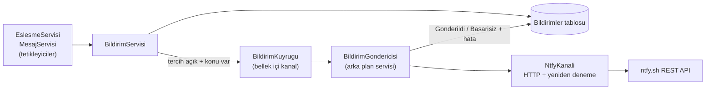

# Hafta 9: Harici API Entegrasyonu: Bildirim

Eşleşme ve mesaj olayları artık bildirim üretir. Bildirim her zaman uygulama içinde görünür. Kullanıcı isterse aynı bildirim harici bir REST API (ntfy) üzerinden telefonuna da gönderilir.

Bu hafta ayrıca web arayüzü sunucuya bağlandı. Kayıt ve giriş artık sunucudaki SQLite veritabanında kalıcı olarak tutuluyor (ayrıntı aşağıda: [Gerçek veritabanı ile giriş](#gerçek-veritabanı-ile-giriş)).

## Seçilen harici API: ntfy

| Alan | Değer |
| --- | --- |
| Servis | [ntfy](https://ntfy.sh): HTTP ile telefona anlık bildirim gönderen açık kaynak servis |
| Neden | REST ile çalışır, telefonda ücretsiz uygulaması var, kart veya telefon numarası istemez. Erişim anahtarı (token) destekler. |
| Uç nokta | `POST https://ntfy.sh/`, JSON gövde: `topic`, `title`, `message`, `tags`, `priority` |
| Kimlik doğrulama | `Authorization: Bearer <anahtar>` başlığı. Anahtar yoksa herkese açık konuya gönderilir. |
| Yanıt | `{"id": "...", "event": "message", "topic": "..."}` |
| Hız sınırı | ntfy aşırı istekte `429 Too Many Requests` döner. |

Telefonda ntfy uygulaması kurulur, Bildirimler sayfasındaki **konu adına** abone olunur. Konu adı bir parola gibidir: bilen herkes o konuya gelen bildirimleri okuyabilir. Bu yüzden en az 12 karakter istenir ve ekranda rastgele konu üreten bir düğme vardır.

## Mimari



| Sınıf | Katman | Görev |
| --- | --- | --- |
| `BildirimServisi` | Business | Bildirim oluşturur, listeler, okundu yapar, tercihleri kaydeder |
| `MesajServisi` | Business | Eşleşmiş iki kişi arasında mesaj, mesajda bildirim tetikler |
| `IBildirimKuyrugu` | Business | Harici gönderim için soyutlama. İş katmanı ntfy'ı tanımaz. |
| `BildirimKuyrugu`, `BildirimGondericisi` | Api | Kuyruk ve arka planda gönderim |
| `NtfyKanali` | Api | REST çağrısı, zaman aşımı, yeniden deneme, yanıt ayrıştırma |

**İstek sırasında harici API çağrılmaz.** Bildirim kuyruğa bırakılır, istek hemen yanıt döner. ntfy yavaş veya kapalı olsa bile istek gönderme, kabul etme ve mesajlaşma etkilenmez.

## Tetikleyiciler: bildirim ne zaman gönderiliyor?

| Olay | Kime | Uygulama içi metin | Telefona giden metin |
| --- | --- | --- | --- |
| Eşleşme isteği kaydedildi | Alıcıya | "Ad Soyad size eşleşme isteği gönderdi." | "Yeni bir eşleşme isteğin var." |
| İstek kabul edildi | Gönderene | "Ad Soyad eşleşme isteğinizi kabul etti." | "Bir eşleşme isteğin kabul edildi." |
| Yeni mesaj | Alıcıya | "Ad Soyad size mesaj gönderdi." | "Yeni bir mesajın var." |
| Deneme | Kendisine | "Deneme bildirimi gönderildi." | "Deneme bildirimi: …" |

- **Ret bildirilmez:** Reddedilen kişi durumu Eşleşmelerim sayfasında görür, telefonuna "reddedildin" bildirimi gitmez.
- **Kişisel veri harici servise gitmez:** Telefona giden metin geneldir; ad, e-posta veya mesaj içeriği ntfy'a gönderilmez.
- **Sıra:** Bildirim, asıl kayıt (istek, kabul, mesaj) veritabanına yazıldıktan sonra oluşturulur. İşlem başarısız olursa bildirim de oluşmaz.

## Bildirim tercihi

`BildirimTercihi` tablosu (migration `Hafta9Bildirim`):

| Alan | Anlamı |
| --- | --- |
| `EslesmeBildirimi` | İstek ve kabulde telefona gönder |
| `MesajBildirimi` | Yeni mesajda telefona gönder |
| `TelefonKonusu` | ntfy konu adı. Boşsa telefona hiç gönderilmez. 12-64 karakter; harf, rakam, `-`, `_`. |

Uygulama içi bildirim tercihten bağımsız olarak her zaman yazılır. Tercih yalnızca telefona gönderimi belirler. `Bildirim` tablosuna `Tur`, `HariciDurum` (`Kapali`, `Bekliyor`, `Gonderildi`, `Basarisiz`) ve `HariciHata` alanları eklendi. Kullanıcı Bildirimler sayfasında her bildirimin telefona gidip gitmediğini ve gitmediyse nedenini görür.

## API anahtarı nerede?

| Ortam | Yer |
| --- | --- |
| Geliştirme | `dotnet user-secrets set "Bildirim:Anahtar" "tk_..." --project src/UyumEslestirme.Api` |
| Yayın | `Bildirim__Anahtar` ortam değişkeni |
| Depo | Hiçbir yerde. `appsettings.json` içinde anahtar alanı yok; `BildirimAyarlari.Anahtar` varsayılanı boş. |

Anahtar yalnızca sunucuda durur. Tarayıcıya (Blazor) hiç gelmez, çünkü ntfy çağrısını sunucu yapar.

## Hata, zaman aşımı ve hız sınırı yönetimi

`NtfyKanali.Gonder` her bildirim için en fazla 3 deneme yapar:

| Durum | Ne oluyor | Yeniden deneme |
| --- | --- | --- |
| 200 + `event: "message"` | Başarılı, ntfy'ın verdiği kimlik günlüğe yazılır | — |
| 200 ama yanıt beklenen biçimde değil | Başarısız sayılır (yanlış adres veya araya giren bir sayfa) | Hayır |
| 401 / 403 | "Bildirim servisi anahtarı reddetti" | Hayır (anahtar değişmeden tekrar denemek işe yaramaz) |
| Diğer 4xx | "İsteği reddetti (kod)" | Hayır |
| 429 | Hız sınırı | Evet, `Retry-After` kadar beklenir (en fazla 10 sn) |
| 5xx | Geçici sunucu hatası | Evet, 1 sn, 2 sn bekleyerek |
| Zaman aşımı (5 sn) | "… saniyede yanıt vermedi" | Evet |
| Bağlantı hatası | "Bildirim servisine bağlanılamadı" | Evet |

Tüm denemeler başarısız olursa bildirim `Basarisiz` olarak işaretlenir ve hata metni kaydedilir. Uygulama çökmez, asıl işlem geri alınmaz.

Kendi tarafımızdaki sınırlar:

- **Mesaj:** Dakikada en fazla 20 mesaj (`MesajServisi.DakikadaAzamiMesaj`). Bir kullanıcı mesaj yağdırarak ntfy hız sınırını tüketemez.
- **Deneme bildirimi:** Kullanıcı başına dakikada 5 (`HizSiniri:DakikadaOneri`).
- **Kuyruk:** En fazla 500 iş. Doluysa bildirim hemen `Basarisiz` ("kuyruk dolu") olur.
- **Sunucu yeniden başlarsa:** Kuyruk bellekte olduğu için bekleyen işler `Basarisiz` ("sunucu yeniden başladı") olarak işaretlenir.

## Yeni API uçları

| Yöntem | Adres | Açıklama |
| --- | --- | --- |
| GET | `/api/bildirimler` | Son 50 bildirim |
| GET | `/api/bildirimler/okunmamis` | `{ "sayi": n }`, menüdeki rozet için |
| POST | `/api/bildirimler/okundu` | Tümünü okundu yap |
| GET / PUT | `/api/bildirimler/tercihler` | Bildirim tercihleri |
| POST | `/api/bildirimler/deneme` | Kendi telefonuna deneme bildirimi (202) |
| GET | `/api/mesajlar/{kisiId}` | Eşleştiğin kişiyle konuşma (gelenleri okundu yapar) |
| POST | `/api/mesajlar` | `{ "kisiId", "icerik" }` |

Hepsi JWT ister. Kullanıcı kimliği yine yalnızca token'dan okunur. Örnek istekler: [UyumEslestirme.Api.http](../src/UyumEslestirme.Api/UyumEslestirme.Api.http).

## Gerçek veritabanı ile giriş

Önceki haftalarda web sürümü yalnızca tarayıcı belleğinde çalışan bir demoydu. Artık aynı web arayüzü API sunucusundan yayınlanıyor:

```powershell
dotnet run --project src/UyumEslestirme.Api
```

JWT imza anahtarı ayarda yoksa sunucu ilk açılışta rastgele üretip `veri/jwt-anahtari.txt` dosyasında saklar; depoya girmez. Canlı sürüm: https://uyumeslestirme.runasp.net

Tarayıcıda http://localhost:5158 açılınca:

- **Kayıt ve giriş:** Kayıt sunucudaki `veri/uyum.db` SQLite dosyasına yazılır, parola PBKDF2 özeti olarak saklanır.
- **Oturum:** Girişte 30 dakikalık JWT alınır, her istekte gönderilir.
- **Kalıcılık:** Sunucu kapatılıp açılsa da hesaplar ve veriler durur.
- **Çok kullanıcılı:** Farklı tarayıcılardan giren kullanıcılar aynı veriyi görür.

Arayüz açılışta `/api/saglik` adresini dener: API varsa sunucu modunda, yoksa (GitHub Pages) demo modunda çalışır. Sayfalar `IUygulama` arayüzünü kullanır; iki modun uygulamaları `ApiUygulama` ve `YerelUygulama` sınıflarıdır.

## Testler

| Dosya | Ne sınar |
| --- | --- |
| `BildirimVeMesajTestleri.cs` | Tetikleyiciler, ret bildirimi gitmemesi, tercih kapalı veya konu yokken gönderilmemesi, kuyruk dolu, konu adı doğrulama, okundu, mesaj kuralları (eşleşmemiş, boş, uzun, hız sınırı) |
| `NtfyKanaliTestleri.cs` | JSON gövde ve `Bearer` anahtarı, anahtarsız gönderim, 5xx/429'da yeniden deneme, 401'de denememe, zaman aşımı, bağlantı hatası, beklenmeyen yanıt |
| `Hafta9Ve10ApiTestleri.cs` | API üzerinden istek, kabul, telefon gönderimi, harici hata durumunda işlemin bozulmaması, mesajlaşma, 401 |

Testlerde ntfy'a gerçekten bağlanılmaz. HTTP katmanı `SahteHttp` ile, kanal `SahteKanal` ile taklit edilir.

## Sözlü sınav hazırlığı

**1. Eşleşme bildirimini ne zaman gönderdin?**
İstek veritabanına kaydedildikten hemen sonra alıcıya, kabul kaydedildikten sonra gönderene. Bunlar `EslesmeServisi.IstekGonder` ve `Yanitla` içindeki `bildirim.Olustur(...)` satırlarıdır. Mesajda `MesajServisi.Gonder` alıcıya bildirir. Ret bilinçli olarak bildirilmez.

**2. Bildirim tercihini nasıl yönettin?**
`BildirimTercihi` tablosunda eşleşme ve mesaj için ayrı açık/kapalı ayarı ve telefon konusu var. Uygulama içi bildirim her zaman yazılır; telefona gönderim yalnızca ilgili tercih açıksa ve konu tanımlıysa yapılır. Karar `BildirimServisi.Olustur` içindeki `hariciIstendi` ifadesindedir.

**3. API anahtarını nasıl ve nerede sakladın?**
Koda ve depoya yazılmadı. Geliştirmede user-secrets'ta, yayında `Bildirim__Anahtar` ortam değişkeninde durur. Anahtar yalnızca sunucuda kullanılır, tarayıcıya hiç gönderilmez.

**4. API çağrısı başarısızsa ne oluyor?**
Asıl işlem (istek, kabul, mesaj) zaten kaydedilmiştir ve etkilenmez, çünkü gönderim arka planda yapılır. Geçici hatalarda (zaman aşımı, 5xx, 429) 3 kez denenir. Kalıcı hatalarda (401, 400) hemen vazgeçilir. Sonunda bildirim `Basarisiz` olur ve hata mesajı kullanıcıya Bildirimler sayfasında gösterilir.

**5. Yanıtı nasıl ayrıştırdın?**
ntfy başarılı yanıtta JSON döner. `NtfyYaniti` kaydına (`id`, `event`) çevrilir. `event` "message" değilse veya `id` boşsa, durum kodu 200 olsa bile başarısız sayılır. Örnek: yanlış adrese gidip HTML sayfası dönmesi. Hata yanıtlarında gövdeye değil durum koduna bakılır.

## Demo (yaklaşık 3 dakika)

1. API'yi çalıştır, iki ayrı tarayıcı penceresinde (biri gizli pencere) iki yeni hesap oluştur, profil ve anketi doldur.
2. A hesabında **Bildirimler** sayfasında "Rastgele konu üret", kaydet. Telefondaki ntfy uygulamasında bu konuya abone ol, **Deneme bildirimi gönder**: telefona bildirim gelir, listede "Telefon: gönderildi" görünür.
3. B hesabından A'ya istek gönder. A'nın menüsünde rozet çıkar, telefona "Yeni bir eşleşme isteğin var" gelir.
4. A isteği kabul eder, **Mesajlar** ile mesaj yazar. B'de bildirim ve mesaj görünür.
5. Hata yönetimi: `Bildirim__Anahtar` değişkenine geçersiz bir değer verip API'yi yeniden başlat. Deneme bildirimi "Telefon: gönderilemedi (401/403)" olur, uygulama çalışmaya devam eder.

## Bilinen sınırlar

- **Kuyruk bellekte:** Sunucu kapanırken gönderilmeyi bekleyen bildirimler kaybolur, `Basarisiz` olarak işaretlenir.
- **Konu adını bilen okuyabilir:** ntfy'da konuyu bilen herkes bildirimleri okuyabilir. Bu yüzden metinler genel tutuldu.
- **Masaüstü sürümü:** Masaüstü uygulamasında henüz Bildirimler ve Mesajlar ekranı yok. Tetikleyiciler orada da çalışır, bildirimler veritabanına yazılır; telefona gönderim yalnızca sunucu sürümünde yapılır.
