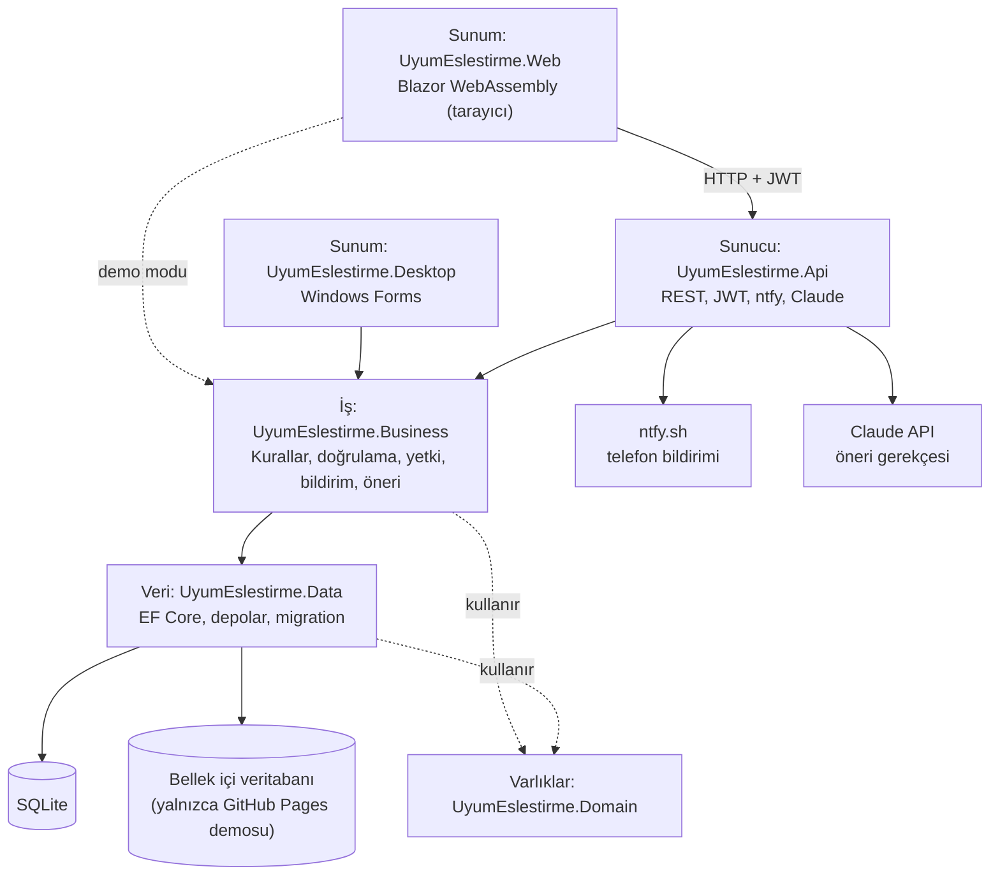

# Mimari

Uygulama üç mantıksal katmandan (sunum, iş, veri) ve ortak bir varlık projesinden oluşur. Sunum katmanında iki arayüz vardır: masaüstü (Windows Forms) ve web (Blazor WebAssembly). 9. haftadan itibaren web arayüzü bir API sunucusu üzerinden ortak veritabanını kullanır.

## Neden katmanlı mimari

- **Test edilebilirlik:** İş kuralları form olmadan birim testiyle sınanır.
- **Sorumluluk ayrımı:** Bir form SQL yazmaz, veri katmanı iş kuralı bilmez.
- **Güvenlik:** Yetki kontrolü iş katmanında olduğu için bir düğmenin gizlenmesine bağlı kalmaz.
- **Değişime dayanıklılık:** Arayüz veya veritabanı değiştiğinde iş kuralları olduğu gibi kalır.

API katmanı ince tutuldu: uç noktalar yalnızca iş katmanındaki servisleri çağırır. Kurallar bir kez yazılır; masaüstü, web demosu ve sunucu aynı kodu kullanır.

## Harici servisler

İş katmanı harici servisleri tanımaz, yalnızca arayüzlerini bilir:

| Arayüz (Business) | Sunucudaki uygulaması (Api) | Yoksa |
| --- | --- | --- |
| `IBildirimKuyrugu` | `BildirimKuyrugu` + `BildirimGondericisi` + `NtfyKanali` | Bildirim yalnızca uygulama içinde |
| `IYapayZekaIstemcisi` | `ClaudeIstemcisi` | Öneri gerekçesi kural tabanlı |

Anahtarlar (JWT, ntfy, Anthropic) yalnızca sunucuda, ortam değişkeni veya user-secrets içinde durur; tarayıcıya ve depoya gitmez.

## Klasör yapısının mantığı

Her katman ayrı bir projedir. Böylece bağımlılık yönünü derleyici denetler: `Data` projesi `Desktop` projesine başvuramaz, başvurursa döngüsel bağımlılık hatası alınır.
