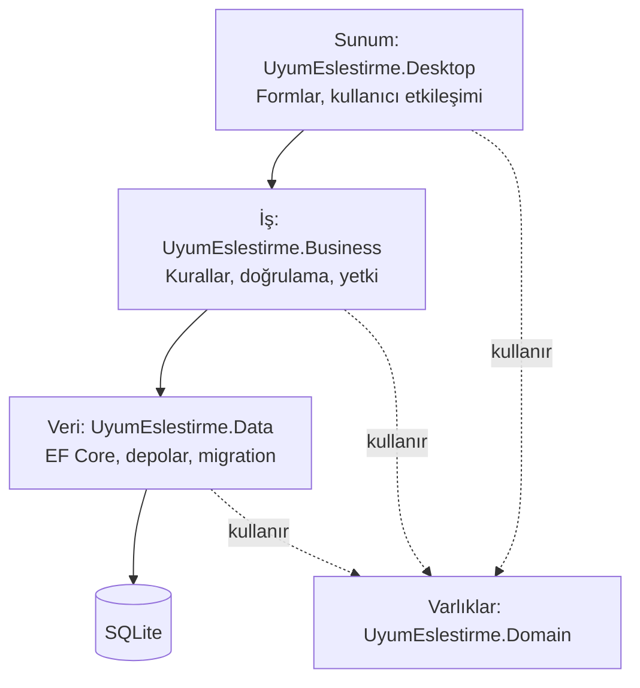

# Mimari

Uygulama üç mantıksal katmandan (sunum, iş, veri) ve ortak bir varlık projesinden oluşur.

## Neden katmanlı mimari

- **Test edilebilirlik:** İş kuralları form olmadan birim testiyle sınanır.
- **Sorumluluk ayrımı:** Bir form SQL yazmaz, veri katmanı iş kuralı bilmez.
- **Güvenlik:** Yetki kontrolü iş katmanında olduğu için bir düğmenin gizlenmesine bağlı kalmaz.
- **Değişime dayanıklılık:** Arayüz veya veritabanı değiştiğinde iş kuralları olduğu gibi kalır.

Tek kullanıcılı bir masaüstü uygulaması için mikroservis veya ayrı sunucu gereksiz karmaşıklık olurdu. Bu nedenle tek süreçte çalışan katmanlı yapı seçildi.

## Klasör yapısının mantığı

Her katman ayrı bir projedir. Böylece bağımlılık yönünü derleyici denetler: `Data` projesi `Desktop` projesine başvuramaz, başvurursa döngüsel bağımlılık hatası alınır.
